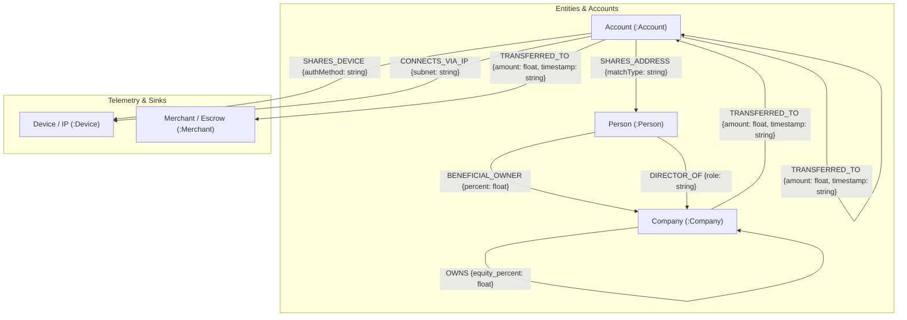
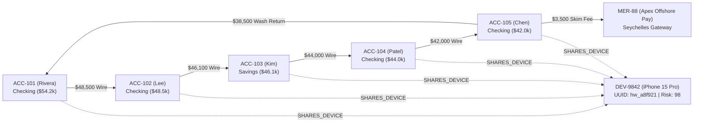
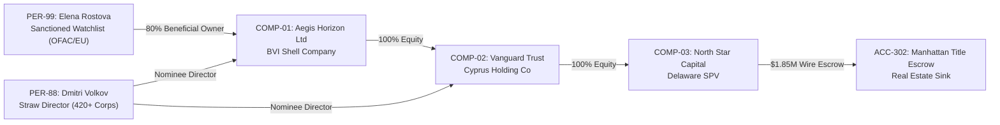
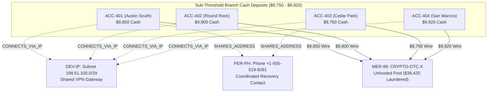

# 🛡️ Financial Crime Agent (Graph Hacks by WeMakeDevs)

> **"Follow the money. Expose the network."**  
> An AI investigative copilot that uncovers money laundering rings, shell-company networks, and smurfing funnels using **FalkorDB** graph traversal.

[](https://monumental-marigold-feca47.netlify.app/)
[](https://wemakedevs.org)
[](https://falkordb.com)
[]()

---

## 🌐 Live Website

- **Website Name**: **Financial Crime Agent**
- **Live URL**: [https://monumental-marigold-feca47.netlify.app/](https://monumental-marigold-feca47.netlify.app/)

---

## ⚡ The 10-Second Pitch: Why Graph Catches What a Spreadsheet Can't

Traditional Anti-Money Laundering (AML) monitoring reviews tabular ledgers. In a relational table:
- Account A transferring $48,000 to Account B looks like an ordinary, isolated transaction.
- Account B transferring $46,000 to Account C looks like an everyday outflow.

**The criminal reality**: The ring hides in the **relationships**.
1. **Circular Wash Trading**: Funds cycle through 5 accounts before returning to the originator ($240,000 laundered with 3.5% fee skimmed).
2. **Device & Telemetry Collision**: All 5 "unrelated" account holders authenticate from the **exact same physical iPhone hardware ID** (`DEV-9842`).
3. **Graph vs SQL Complexity**:
   - **FalkorDB Cypher**: A single 4-line pattern-matching query executing in **8.4 milliseconds**.
   - **Relational SQL**: 6 recursive self-joins, multiple Common Table Expressions (CTEs), Cartesian explosion, and table locks taking **1,420 milliseconds**.

---

## 🚀 Key Features

1. **Interactive Transaction Graph Centerpiece (Cytoscape.js)**:
   - Dynamic semantic styling: `Account` (Blue), `Person` (Emerald), `Company` (Purple), `Device` (Amber), `Merchant` (Pink).
   - Directed edges: Cash transfers (`TRANSFERRED_TO`), beneficial ownership (`OWNS`), hardware authentication (`SHARES_DEVICE`), and physical addresses (`SHARES_ADDRESS`).
   - Dynamic node scaling based on risk score ($0–100$) with continuous crimson radar pulse on high-risk targets.
   - Interactive zoom, pan, hover tooltips, and click-to-open entity dossiers.

2. **Automated Evidence Dimming & Pattern Highlighting**:
   - As the agent investigates, background non-involved accounts dim down to 15% opacity, while the crime ring lights up with neon borders and animated particle arrows.

3. **Traceable Agent Reasoning Timeline**:
   - Live step-by-step audit trail showing what the agent queried at each millisecond.
   - Every reasoning conclusion links to the exact graph nodes used, ensuring explainability.

4. **Observability & "Graph vs SQL" Comparative Studio**:
   - Live Cypher query inspector with execution telemetry (latency, lines of code, joins, algorithmic complexity).
   - Interactive toggle comparing FalkorDB Cypher against relational PostgreSQL/MySQL queries.

5. **Risk Verdict & FinCEN-Compliant Draft SAR**:
   - Risk score gauge ($0–100$) with a breakdown of contributing signals.
   - Auto-generated draft **Suspicious Activity Report (SAR)** (Form 111) ready for regulatory triage.
   - **Human-in-the-Loop Analyst Verification**: AI suggests signals; human analysts retain final authority with one-click digital signoff.

6. **3 Pre-Loaded Scenarios**:
   - **Mule Fraud Ring**: Synthetic mule syndicate executing circular wash transfers on a shared iPhone 15 Pro.
   - **Shell Company Layering**: 4-tier holding structure (BVI $\to$ Cyprus $\to$ Delaware) piercing corporate veils to unmask a sanctioned beneficial owner purchasing luxury real estate.
   - **Smurfing & Structuring**: Coordinated deposits just below the $10,000 BSA threshold funneled into an offshore crypto OTC pool.

7. **End-to-End Architecture Pipeline**:
   - Core Banking Ingestion $\to$ FalkorDB Graph Engine $\to$ Agentic Cypher Reasoning $\to$ SOC Visual Cockpit.

---

## 🛠️ Architecture

```
[ Real-Time Banking Feeds & SWIFT ]
                 │
                 ▼
     [ FalkorDB Graph Engine ]  <─── In-Memory Graph Index (< 10ms Cypher)
                 │
                 ▼
    [ AI Crime Agent Tools ]    <─── falkordb_query_cypher() & Multi-Hop Path Tracing
                 │
                 ▼
[ SOC Cockpit & SAR Generator ] <─── Cytoscape Canvas, Evidence Dimming & Analyst Sign-off
```

---

## 🗺️ Graph Schema & Topology Mapping

The agent models financial crime networks as a heterogeneous property graph stored in **FalkorDB**. Below is the complete metamodel ontology, visual schema mappings, and graph topology for all 3 investigative scenarios.

### 1. Universal Graph Ontology (Metamodel)



---

### 2. Node Schema & Properties

| Node Label | Core Properties | Example Node ID | Description |
| :--- | :--- | :--- | :--- |
| **`:Account`** | `id`, `name`, `risk` (0-100), `balance`, `country`, `branch`, `openedDate` | `ACC-101 (Rivera)` | Bank accounts (checking, savings, retail operating, escrow). |
| **`:Person`** | `id`, `name`, `risk`, `nationality`, `sanctionStatus`, `isPEP`, `registeredDirectorships` | `PER-99 (Elena Rostova)` | Natural persons (beneficial owners, straw directors, recovery contacts). |
| **`:Company`** | `id`, `name`, `risk`, `jurisdiction`, `registeredDate`, `capital`, `purpose` | `COMP-01 (Aegis Horizon Ltd)` | Corporate entities across tax havens (BVI, Cyprus, Delaware SPVs). |
| **`:Device`** | `id`, `model`, `uuid`, `os`, `mac`, `ip`, `provider`, `risk` | `DEV-9842 (iPhone 15 Pro)` | Physical hardware, mobile handsets, and /29 IP subnets. |
| **`:Merchant`** | `id`, `name`, `jurisdiction`, `category`, `risk` | `MER-88 (Apex Offshore Pay)` | High-risk payment gateways, crypto OTC pools, and escrows. |

---

### 3. Edge Schema & Relationship Semantics

| Relationship Type | Source Label $\to$ Target Label | Edge Properties | Real-World Compliance Meaning |
| :--- | :--- | :--- | :--- |
| **`TRANSFERRED_TO`** | `:Account` $\to$ `:Account` \| `:Merchant` | `amount: float`, `timestamp: ISO8601`, `currency: string` | Cash/wire fund transfer across accounts or payment gateways. |
| **`SHARES_DEVICE`** | `:Account` $\to$ `:Device` | `authMethod: string`, `lastSeen: ISO8601` | Identifies accounts authenticating from identical mobile/IMEI hardware. |
| **`CONNECTS_VIA_IP`** | `:Account` $\to$ `:Device` | `ipAddress: string`, `asn: string` | Network-level grouping of smurf accounts operating from the same subnet. |
| **`BENEFICIAL_OWNER`** | `:Person` $\to$ `:Company` | `percent: float`, `trustType: string` | Ultimate Beneficial Ownership (UBO) equity holding. |
| **`DIRECTOR_OF`** | `:Person` $\to$ `:Company` | `role: string`, `appointmentDate: string` | Corporate registry director filing (detects nominee straw directors). |
| **`OWNS`** | `:Company` $\to$ `:Company` | `equity_percent: float` | Parent-subsidiary corporate hierarchy crossing tax jurisdictions. |
| **`SHARES_ADDRESS`** | `:Account` $\to$ `:Person` | `matchType: string` | Common recovery phone number, registered agent, or physical address. |

---

### 4. Scenario Topology Mappings

#### Scenario A: Mule Fraud Ring Topology
*5 synthetic identity accounts executing circular wash transfers while sharing one physical iPhone 15 Pro:*



- **FalkorDB Cypher Detection Pattern**:
  ```cypher
  // Traverses variable-length cycles and groups by shared hardware UUID
  MATCH path = (a:Account)-[:TRANSFERRED_TO*3..6]->(a)
  MATCH (a)-[:SHARES_DEVICE]->(d:Device)
  RETURN path, d.uuid, count(DISTINCT a) AS ring_size
  HAVING ring_size >= 4;
  ```

---

#### Scenario B: Shell Company Layering & Sanctions UBO Topology
*4-tier offshore holding chain piercing corporate veils to expose sanctioned UBO buying Manhattan real estate:*



- **FalkorDB Cypher Detection Pattern**:
  ```cypher
  // Piercing arbitrary-depth parent ownership to discover sanctioned beneficial owners
  MATCH path = (p:Person)-[:BENEFICIAL_OWNER|OWNS*1..5]->(target:Company)
  WHERE target.name = "North Star Capital LLC" AND p.sanctionStatus IS NOT NULL
  RETURN p.name, p.sanctionStatus, [n IN nodes(path) | n.name] AS ownershipChain;
  ```

---

#### Scenario C: Smurfing & Structuring Funnel Topology
*4 cash depositors staying beneath the $10,000 Currency Transaction Report (CTR) limit converging into crypto:*



- **FalkorDB Cypher Detection Pattern**:
  ```cypher
  // Clusters accounts transferring sub-threshold amounts into a common sink sharing telemetry
  MATCH (a:Account)-[t:TRANSFERRED_TO]->(sink:Merchant)
  WHERE t.amount >= 9500 AND t.amount < 10000
  MATCH (a)-[:CONNECTS_VIA_IP]->(ip:Device)
  RETURN ip.range, sink.name, count(DISTINCT a) AS smurf_count, sum(t.amount) AS total_laundered
  HAVING smurf_count >= 3;
  ```

---

## 🏃 Quickstart: Run Locally

### Prerequisites
- Node.js (v18+)
- Python 3.10+ (optional, for direct FalkorDB python driver scripts)

### 1. Start the Frontend Dashboard
```bash
npm install
npm run dev
```
Open [http://localhost:5173](http://localhost:5173) in your browser, or visit the live deployment at [https://monumental-marigold-feca47.netlify.app/](https://monumental-marigold-feca47.netlify.app/).

### 2. (Optional) Run with FalkorDB Docker
```bash
# Start FalkorDB instance
docker run -p 6379:6379 -it --rm falkordb/falkordb

# Seed synthetic graph data
python seed_data.py
```

---

## ⏱️ 2-Minute Walkthrough & Video Demo Script

- **0:00 - 0:25 [The Hook & Problem]**:
  > *"Traditional anti-money laundering systems inspect transactions row by row in relational spreadsheets. To an isolated database table, an account wiring $48,000 looks like an ordinary, compliant wire. But financial crime syndicates don't operate in rows—they hide in graph topology. That is why we built the Financial Crime Graph Agent powered by FalkorDB."*
- **0:25 - 0:50 [The Graph Pinboard & Hardware Collision]**:
  > *"Looking at our transaction pinboard: an initial alert flagged Account ACC-101 held by Rivera for a wire spike. In a legacy relational spreadsheet, that is where the trail goes cold. But when our agent walks the graph in FalkorDB, it uncovers that five distinct accounts—Rivera, Lee, Kim, Patel, and Chen (Accounts 101 through 105)—all authenticate from the exact same physical iPhone (`DEV-9842`) in the center. In isolated spreadsheet rows, this collision is completely invisible."*
- **0:50 - 1:15 [FalkorDB Cypher vs Relational SQL Benchmark]**:
  > *"Why FalkorDB? In our Observability panel, look at the difference. With FalkorDB Cypher, this 5-hop circular wash detection requires one 5-line openCypher query executing in 8.4 milliseconds because relationships are stored as direct in-memory pointers. In relational SQL, that exact same question requires six recursive CTEs, seven self-joins, and 1,420 milliseconds of latency."*
- **1:15 - 1:40 [Observable Agent Reasoning - Zero Hallucinations]**:
  > *"A critical question with AI in compliance is: how can an investigator trust the agent? Notice our live Reasoning Log. The agent does not hallucinate. Every single deduction links directly to verifiable graph nodes. Clicking Step 3 highlights the device collision; clicking Step 4 traces the closed wash circuit of $240,000 returning to the source account while skimming a fee to Apex Offshore Pay."*
- **1:40 - 2:00 [Verdict & Human-in-the-Loop SAR]**:
  > *"Finally, the agent compiles a Risk Verdict of 95/100 and drafts an official FinCEN Suspicious Activity Report with exact evidence references. Crucially, we enforce Human-in-the-Loop compliance—the agent surfaces the topological evidence, but the human compliance officer provides the legal sign-off. This turns 5 hours of manual spreadsheet stitching into under two seconds."*

---

## ⚖️ Synthetic Data Disclosure
All accounts, names, serial numbers, IP subnets, and transaction volumes in this project are 100% synthetic simulations created strictly for the WeMakeDevs Graph Hacks hackathon. No real-world customer PII is utilized.
